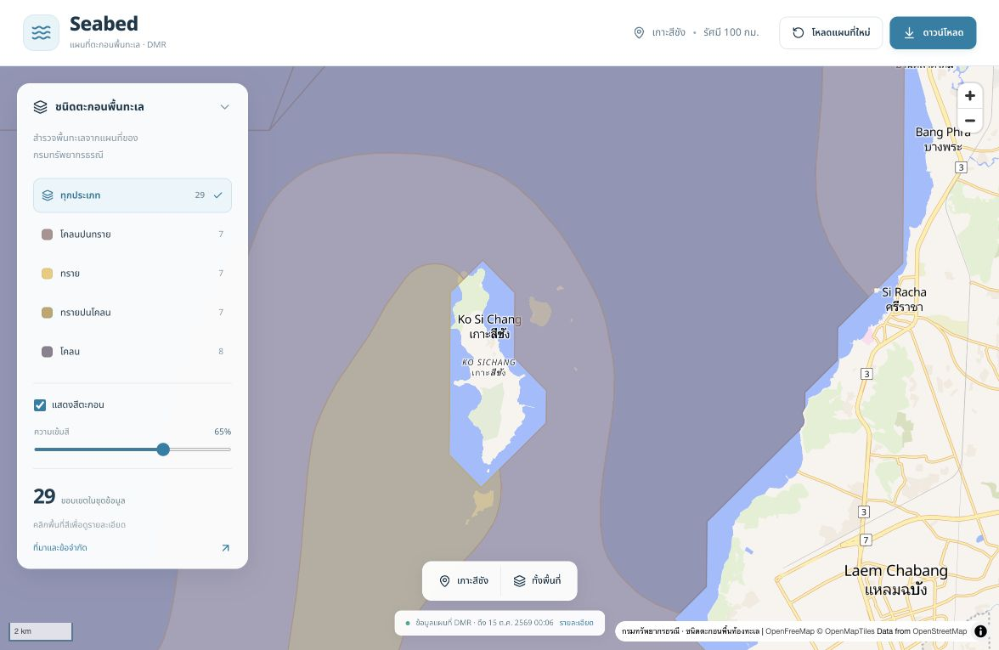

# DMR Seabed — แผนที่ตะกอนและข้อมูลประกอบตำแหน่งตกของลูกปู

โปรเจกต์แยกสำหรับดู **ชนิดตะกอนพื้นทะเลจากกรมทรัพยากรธรณี (DMR)** และนำไปประกอบผลพยากรณ์ตำแหน่งของลูกปู มีทั้งหน้าเว็บแผนที่ ตัวดาวน์โหลดข้อมูล และ Python สำหรับตรวจชนิดตะกอน ณ พิกัดปลายทาง

**ข้อมูลใน repo เป็นข้อมูลแผนที่ที่เผยแพร่โดย DMR ไม่ใช่ผลทำนายว่าปูจะรอดหรือพื้นที่เหมาะสำหรับปล่อย** ตัวพยากรณ์การเคลื่อนที่ของเพื่อนต้องคำนวณพิกัดมาก่อน แล้วใช้โปรเจกต์นี้อ่านชนิดตะกอนที่พิกัดนั้น



## สิ่งที่มีให้

- เว็บ React + MapLibre: กรองตะกอน 4 ประเภท ปรับความเข้มสี คลิกอ่านรายละเอียด และดาวน์โหลด GeoJSON
- ชุดข้อมูลเริ่มต้นรัศมี **100 กม. รอบเกาะสีชัง** มี **29 ขอบเขต**
- ดาวน์โหลดข้อมูล DMR ใหม่ โดยกำหนดศูนย์กลางและรัศมีได้
- ตรวจพิกัดจุดเดียวหรือหลายจุดจากผลจำลองด้วย Python
- เก็บข้อมูลต้นทางและ snapshot พร้อมที่มา เวลา และ SHA-256
- ใช้กับระบบอื่นได้ด้วยไฟล์ GeoJSON โดยไม่จำเป็นต้องใช้หน้าเว็บของ repo นี้

## 1. เริ่มใช้หน้าเว็บ

ต้องมี Node.js **22.18 ขึ้นไป** และ npm ชุดข้อมูลตัวอย่างรวมอยู่แล้ว จึงเปิดเว็บได้ทันทีหลังติดตั้งแพ็กเกจ

```bash
git clone https://github.com/natthawatT06/dmr-seabed.git
cd dmr-seabed
npm ci
npm run dev
```

เปิด **http://localhost:5174/**

สำหรับ build และเปิดแบบ production ในเครื่อง:

```bash
npm run build
npm start
```

เปิด **http://localhost:3001/** ตั้ง `PORT` และ `HOST` ได้หากต้องการใช้เครื่องหรือพอร์ตอื่น เช่น `HOST=0.0.0.0 PORT=8080 npm start`

หน้าเว็บอ่านชุดข้อมูลที่บันทึกไว้ใน `public/` ปุ่ม **โหลดแผนที่ใหม่** อ่านไฟล์ชุดนี้อีกครั้ง ส่วนการดึงชุดใหม่จาก DMR ใช้ขั้นตอนถัดไป

แผนที่พื้นหลังมาจาก OpenFreeMap / OpenStreetMap สีและข้อมูลตะกอนมาจาก DMR

## 2. แหล่งข้อมูลและหลักการรวบรวม

**ผู้จัดทำข้อมูล:** กรมทรัพยากรธรณี กระทรวงทรัพยากรธรรมชาติและสิ่งแวดล้อม

- [บัญชีข้อมูลทางการ: ชนิดตะกอนพื้นท้องทะเล](https://data.dmr.go.th/dataset/seafloor_surficial_sediment)
- [ArcGIS REST Service](https://gisportal.dmr.go.th/arcgis/rest/services/ENVI/SEAFLOOR_SURFICIAL_SEDIMENT/MapServer)
- [ชั้นข้อมูลที่เรียกใช้: layer 0](https://gisportal.dmr.go.th/arcgis/rest/services/ENVI/SEAFLOOR_SURFICIAL_SEDIMENT/MapServer/0)

บัญชีข้อมูลของ DMR ระบุว่าใช้การเก็บตัวอย่างตะกอนแบบลาก วิเคราะห์ขนาดเม็ดตะกอน และแบ่งชนิดตาม Shepard (1954) มาตราส่วน **1:50,000** บัญชีข้อมูลลิงก์มายังบริการเดียวกับที่ repo นี้ใช้

วันที่ที่ต้องแยกให้ออก:

| วันที่ | ความหมาย |
|---|---|
| `fetchedAt` ใน manifest | เวลาที่โปรแกรมของเราดาวน์โหลดชุดข้อมูล |
| 22 ธันวาคม 2566 | วันที่ปรับปรุงชุดข้อมูลที่บัญชีข้อมูล DMR ระบุ |
| 1 เมษายน 2565 | เวลาอ้างอิงที่บัญชีข้อมูลระบุ |
| 13 สิงหาคม 2569 | วันที่ปรับปรุง **รายการบัญชีข้อมูล** ในระบบ |
| `observedAt: null` | ยังไม่มีวันที่สำรวจเฉพาะขอบเขตนั้น |

วันที่ปรับปรุงรายการหรือวันที่ดาวน์โหลด **ไม่ได้หมายถึงเพิ่งสำรวจพื้นทะเลใหม่ในวันนั้น** การตรวจบัญชีข้อมูลที่บันทึกไว้ไม่รับรองว่า API ปัจจุบันเป็น release เดียวกับวันที่ในบัญชี

รายละเอียดบัญชีข้อมูลที่ตรวจไว้เก็บใน `data/source/dmr-catalogue-summary.json` เป็น **สรุปที่ตรวจสอบจากหน้าเผยแพร่** ไม่ใช่ response ดิบจาก API

## 3. วิธีดึงข้อมูลใหม่

ใช้ Python **3.12 ขึ้นไป** และคำสั่ง `curl` ที่อยู่ใน PATH

```bash
python3 -m venv .venv
source .venv/bin/activate
python -m pip install -r requirements.txt
python scripts/download_dmr.py
```

หากต้องการใช้ dependencies ตามรุ่นที่ส่งมอบ ใช้ `python -m pip install -r requirements.lock.txt` แทน ไฟล์นี้บันทึกเฉพาะแพ็กเกจของ virtual environment สำหรับ DMR

Windows ใช้ `.venv\Scripts\Activate.ps1` เพื่อเปิด virtual environment และใช้ `python` แทน `python3` หากเครื่องติดตั้งในชื่อนั้น

กำหนดรัศมีหรือศูนย์กลางเอง:

```bash
python scripts/download_dmr.py --radius-km 150
python scripts/download_dmr.py --center 100.8125 13.155 --radius-km 50
```

หรือหลังเปิด virtual environment แล้ว:

```bash
npm run data:download -- --radius-km 100
```

รัศมีรองรับ **1–250 กม.** ศูนย์กลางรองรับบริเวณอ่าวไทยตามข้อจำกัด CLI: longitude 99–103, latitude 10–15

### ขั้นตอนของตัวดาวน์โหลด

1. สร้างวงรัศมีด้วย WGS84 geodesic จำนวน 360 จุดขอบ ใช้ศูนย์กลางเกาะสีชังเป็นค่าเริ่มต้น
2. อ่านเมทาดาทาชั้นข้อมูล แล้วส่งกรอบสี่เหลี่ยมครอบวงไปยัง `/query` ใช้ `inSR=4326` และ `returnIdsOnly=true`
3. ขอ geometry และฟิลด์ของ object IDs ทั้งหมดด้วย `f=geojson`, `outSR=4326`
4. ตรวจว่าจำนวน/IDs ครบ ไม่ซ้ำ และไม่มี `exceededTransferLimit` หากไม่ครบจะหยุด ไม่ประกาศว่าได้ข้อมูลครบ
5. เก็บ response ต้นฉบับ พร้อมคำนวณ SHA-256
6. ตัดรูปหลายเหลี่ยมให้เหลือเฉพาะวงรัศมี ถ้าขอบเขตไม่มีพื้นที่ในวงให้ตัดออก
7. หาก topology ไม่ถูกต้อง ใช้ `make_valid` และเก็บสถานะ `geometryRepaired` ไว้ ไม่มีการสร้างชนิดตะกอนใหม่
8. คำนวณพื้นที่ใน UTM zone 47N (**EPSG:32647**) และใช้ union เพื่อไม่รวมพื้นที่ซ้อนซ้ำภายในประเภทเดียวกัน
9. บันทึกไฟล์ใช้งานปัจจุบันและ snapshot ประจำการดึงครั้งนั้น

สำหรับชุดเริ่มต้น API พบ **31 objects ในกรอบสี่เหลี่ยม** หลังตัดเข้าวง 100 กม. เหลือ **29 objects** จำนวนนี้เป็นจำนวนขอบเขตแผนที่ ไม่ใช่จำนวนจุดที่เก็บตัวอย่างตะกอน

ตัวดาวน์โหลดจำกัดไว้ไม่เกิน 2,000 objects และ response 64 MB; timeout 60 วินาทีต่อ request หากเกินให้ลดรัศมีหรือแยกพื้นที่ ขณะนี้ยังไม่มี pagination สำหรับการดึงระดับประเทศ

หลังดึงใหม่ ถ้าใช้ production server ต้อง build ใหม่:

```bash
npm run build
```

**ไม่มีบัญชี API หรือ token ที่ต้องกรอก** สำหรับบริการ DMR ที่ใช้ในชุดนี้

## 4. วิธีเก็บข้อมูล

```text
dmr-seabed/
├── public/data/habitat/regional-seabed/
│   ├── dmr-sediment.geojson       # ชุดตัดขอบเขตแล้ว ใช้กับเว็บ/ระบบของเพื่อน
│   └── dmr-manifest.json          # ที่มา เวลา จำนวน พื้นที่ ข้อจำกัด SHA-256
├── data/source/
│   ├── dmr-source-<sha>.geojson    # response ดิบที่ดึงมาจาก DMR ไม่แก้เนื้อหา
│   ├── dmr-layer-metadata.json    # เมทาดาทา API ล่าสุด
│   ├── dmr-object-ids.json        # IDs ที่ค้นพบในกรอบล่าสุด
│   └── dmr-catalogue-summary.json # สรุปบัญชีข้อมูลที่ตรวจไว้
├── data/snapshots/<time>-<sha>/   # GeoJSON/manifest ของแต่ละการดึง
├── scripts/                     # ดาวน์โหลดและอ่านพิกัด
├── examples/                    # พิกัดตัวอย่างสังเคราะห์และรูปแบบผลลัพธ์
├── src/                         # หน้าเว็บ
└── docs/                        # วิธีเชื่อมต่อและรายละเอียดข้อมูล
```

- `public/` เป็นชุดปัจจุบัน อัปเดตเมื่อดาวน์โหลดสำเร็จ
- response ดิบตั้งชื่อด้วย hash เพื่อเก็บข้อมูลแต่ละฉบับไว้
- `data/snapshots/` เก็บฉบับที่ใช้งาน เพื่อย้อนกลับหรือระบุได้ว่าผลพยากรณ์ใช้ข้อมูลชุดไหน
- เมื่อดึงใหม่ metadata/IDs ใน `data/source/` จะเป็นชุดล่าสุด ส่วน downloader จะคัดลอกไป snapshot ใหม่ด้วย
- ชุดเริ่มต้นที่ย้ายมาจากงานเดิมมี snapshot GeoJSON/manifest และ response ต้นทางใน `data/source/`
- เก็บ `sourceFetchedAt` และ `sourceSha256` คู่กับผลจำลองทุกครั้ง อย่าใช้ `OBJECTID` อย่างเดียวอ้างอิงข้ามรุ่น

ข้อมูลที่แชร์ใน repo เป็นชุดข้อมูลพื้นที่สาธารณะของ DMR ส่วนผลจำลองของผู้ใช้ให้เก็บใน `outputs/` ซึ่งถูก `.gitignore` ไว้

## 5. รูปแบบข้อมูลและประเภทตะกอน

GeoJSON ใช้พิกัด **EPSG:4326 `[longitude, latitude]`** ระวังอย่าสลับ lat/lon

| `classKey` | ความหมาย | จำนวนในชุดเริ่มต้น |
|---|---|---:|
| `sand` | ทราย | 7 |
| `muddy_sand` | ทรายปนโคลน | 7 |
| `sandy_mud` | โคลนปนทราย | 7 |
| `mud` | โคลน | 8 |
| `unknown` | ชนิดจากต้นทางที่ยังไม่อยู่ใน mapping ของโปรแกรม | 0 |

ฟิลด์สำคัญใน `feature.properties`:

| ฟิลด์ | ความหมาย |
|---|---|
| `id` | รหัสสำหรับใช้งาน เช่น `dmr-600` |
| `OBJECTID`, `SS_ID`, `SS_CODE` | รหัสจาก DMR |
| `SS_NAME_T`, `SS_NAME_E` | ชนิดตะกอนชื่อไทย/อังกฤษจากต้นทาง |
| `PROVINCE_T`, `PROVINCE_E` | จังหวัดจากต้นทาง |
| `classKey`, `color` | key และสีที่เราเพิ่มเพื่อแสดงผล |
| `clippedAreaM2` | พื้นที่ของรูปหลายเหลี่ยมหลังตัดเข้าวง หน่วย ตร.ม. |
| `geometryRepaired` | เคยแก้ topology เพื่อประมวลผลหรือไม่ |
| `observedAt` | วันที่สำรวจเฉพาะขอบเขต ซึ่งยังไม่ทราบ |
| `fieldVerified` | `false` — ทีมเรายังไม่ตรวจภาคสนาม |
| `habitatSuitability` | `unknown` — ยังไม่สรุปความเหมาะสมกับปู |

`datasetMetadata` ใน GeoJSON มีเนื้อหา manifest ชุดเดียวกัน รวมที่มาและข้อจำกัด

## 6. ให้ระบบพยากรณ์ของเพื่อนนำไปใช้

### ทางเลือก A: เอาไฟล์ไปอ่านในระบบเดิม

ใช้ `public/data/habitat/regional-seabed/dmr-sediment.geojson` ได้โดยตรง โหลด polygons แล้วทำ **point-in-polygon** กับพิกัดปลายทางจากตัวพยากรณ์

ถ้าเปิดเว็บอยู่ มี URL สำหรับอ่านไฟล์:

```text
http://localhost:5174/data/habitat/regional-seabed/dmr-sediment.geojson
http://localhost:5174/data/habitat/regional-seabed/dmr-manifest.json
```

นี่เป็น static data endpoint ไม่ใช่ API ที่รับพิกัดและคำนวณให้ และ localhost หมายถึงเครื่องที่เปิดเว็บอยู่

### ทางเลือก B: ใช้ Python ที่เตรียมให้

ตัวพยากรณ์ส่งจุดปลายทางเป็น JSON array เช่น:

```json
[
  {
    "id": "particle-001",
    "longitude": 100.7,
    "latitude": 13.1,
    "elapsedDays": 20,
    "predictionTime": "2026-11-04T00:00:00Z"
  }
]
```

พิกัด/เวลาในตัวอย่างนี้เป็นตัวอย่างรูปแบบ ไม่ใช่ผลจำลองจริง การระบุ 20 วันไม่ได้ยืนยันว่าลูกปูทุกตัวอยู่ในระยะ C1

```bash
python scripts/lookup_points.py \
  --input examples/settlement-points.json \
  --output outputs/settlement-with-sediment.json
```

ต้องการผลเป็นจุด GeoJSON ให้เปลี่ยนนามสกุล output:

```bash
python scripts/lookup_points.py \
  --input examples/settlement-points.json \
  --output outputs/settlement-with-sediment.geojson
```

หรือเรียกจากโค้ด Python เมื่อ root ของ repo อยู่ใน import path:

```python
from scripts.dmr_lookup import DMRDataset

sediment = DMRDataset()  # โหลด/สร้าง spatial index ครั้งเดียว
result = sediment.lookup(longitude=100.7, latitude=13.1)

if result["status"] == "mapped":
    print(result["classKey"], result["sedimentNameTh"])
else:
    print(result["status"])
```

**สถานะที่ต้องรองรับ:**

| `status` | ความหมายและการใช้งาน |
|---|---|
| `mapped` | มีขอบเขตตะกอนที่ตรงพิกัด คืนชนิดตะกอนได้ |
| `unmapped` | อยู่ในวงข้อมูลแต่ไม่มี polygon ตรงพิกัด เก็บเป็นไม่ทราบ |
| `outside-coverage` | พิกัดอยู่นอกวงข้อมูล ต้องขยายพื้นที่หรือหาข้อมูลเพิ่ม |
| `ambiguous` | มีหลายชนิดตะกอนซ้อน/แตะพิกัด คืนทุก match ไม่เลือกชนิดใดเอง |
| `unrecognized-class` | มี polygon แต่ชนิดต้นทางยังไม่อยู่ใน mapping |

ใช้ `covers()` รวมจุดที่อยู่บนขอบ polygon ดังนั้นขอบระหว่างคนละชนิดอาจได้ `ambiguous` ขอบหลาย polygon ที่เป็นชนิดเดียวกันคืน `mapped` พร้อมทุก match

ผลลัพธ์เก็บข้อมูลพยากรณ์เดิมไว้ใน `prediction` และผลตรวจตะกอนไว้ใน `dmr` เสมอ ส่วน `habitatSuitability` ยังเป็น `unknown` และ `survivalProbability` เป็น `null`

มี [ผลลัพธ์ตัวอย่าง](examples/settlement-with-sediment.json) จากจุด **สังเคราะห์** 3 จุด: พื้นที่ทราย, จุดที่ไม่มี polygon ตรงพิกัด และจุดนอกวงข้อมูล ตัวอย่างนี้ไม่ใช่ผลพยากรณ์จริงหรือจุดแนะนำปล่อยปู

รายละเอียดเพิ่มเติม: [docs/INTEGRATION.md](docs/INTEGRATION.md)

## 7. หลักการใช้กับงานปู C1

ใช้ชนิดตะกอนเป็น **ตัวแปรประกอบ** ผลพยากรณ์ตำแหน่ง เช่น รายงานว่าสัดส่วนจุดปลายทางตกในทราย โคลน หรือพื้นที่ที่ยังไม่มีข้อมูลเท่าไร

- ยังไม่ควรแปลง `sand` เป็น “เหมาะสม” หรืออัตรารอดโดยอัตโนมัติ
- พื้นทรายเป็นจุดเริ่มต้นในการเลือกพื้นที่ไปสำรวจ แต่ต้องตรวจอาหาร ที่หลบซ่อน สภาพน้ำและการพบลูกปูจริง
- ชั้นข้อมูลนี้ไม่บอกหญ้าทะเล ความลึก กระแสน้ำ หรือสิ่งมีชีวิตที่เป็นอาหาร
- ขอบเขตสีเป็นแผนที่ระดับพื้นที่ มาตราส่วน 1:50,000 ไม่รับรองพื้นทะเลทุกพิกัดหรือความละเอียดเพิ่มเมื่อซูม
- ไม่มีการทำ point lookup แล้วสร้างคะแนน AI หรือเลือกจุดปล่อยใน repo นี้

## 8. การอ้างอิงและสิทธิ์ข้อมูล

บัญชีข้อมูล DMR ระบุ **Creative Commons Attributions** โดยไม่ได้ระบุเวอร์ชันไว้ ควรอ้างอิงอย่างน้อย:

> กรมทรัพยากรธรณี. ชนิดตะกอนพื้นท้องทะเล. ระบบบัญชีข้อมูลกรมทรัพยากรธรณี. พร้อมระบุ URL และวันดึงข้อมูลจาก manifest

อ้างอิงต้นทางที่ https://data.dmr.go.th/dataset/seafloor_surficial_sediment

เงื่อนไขของข้อมูล DMR แยกจากโค้ดใน repo นี้ โค้ดยังไม่ได้ประกาศสัญญาอนุญาตโอเพนซอร์สทั่วไป การเผยแพร่ repo แบบ public ไม่เปลี่ยนสิทธิ์ข้อมูลของเจ้าของต้นทาง

## 9. หากเปิดไม่ขึ้น

- ทำ `npm ci` ก่อนรัน และใช้ Node ตามเวอร์ชันที่ระบุ
- เปิด virtual environment ก่อนเรียก Python และติดตั้ง `requirements.txt`
- ดาวน์โหลดใหม่ไม่สำเร็จ: ตรวจอินเทอร์เน็ต/บริการ DMR และลดขนาดพื้นที่หากเกิน limit
- หน้าเว็บ production ยังเป็นข้อมูลเดิม: ทำ `npm run build` แล้วรีเฟรช
- แผนที่พื้นหลังต้องใช้อินเทอร์เน็ต ข้อมูลตะกอนที่อ่านจากไฟล์ยังเป็นชุดที่เก็บไว้ ไม่ใช่ข้อมูลสด

เวอร์ชันส่งมอบคอมไพล์ TypeScript และ build production แล้ว ไม่ได้เพิ่มหรือรันชุดทดสอบอัตโนมัติ
